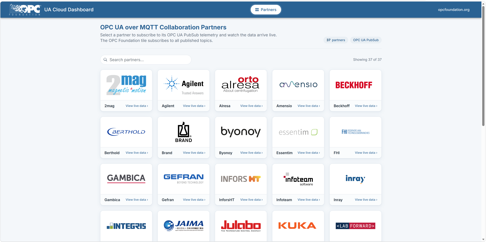
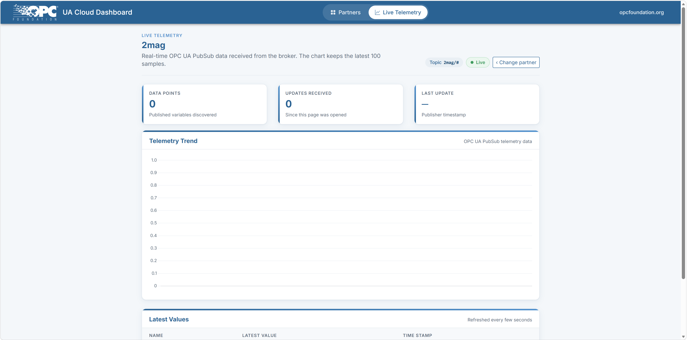

# UA Cloud Dashboard
A cross-platform OPC UA cloud dashboard reference implementation leveraging Kafka and MQTT. It runs in a Docker container and displays OPC UA PubSub telemetry data, read directly from a Kafka broker or an MQTT broker. It supports both JSON and binary (UADP) payloads as well as OPC UA Complex Types decoding.

The look and feel is aligned with other OPC Foundation web applications, such as the [UA Cloud Library](https://uacloudlibrary.opcfoundation.org).

## Features

### Partner Overview

The start page lists the UA Cloud Initiative collaboration partners as a searchable grid of logo tiles. Selecting a tile (re)subscribes the dashboard to the broker topic used by that partner and opens the live telemetry view. The OPC Foundation tile subscribes to all topics (`#`).

### Live Telemetry

The live telemetry view shows the data published by the selected partner in real time:

* **Status header** - the selected partner, the subscribed broker topic and the live connection status of the browser to the dashboard.
* **Key figures** - the number of discovered data points, the number of updates received since the page was opened and the timestamp of the latest update.
* **Telemetry trend** - a line chart of all numeric values, keeping the latest 100 samples per data point.
* **Latest values** - a table with the most recent value and timestamp of every data point, including non-numeric values.

The view is pushed to the browser via SignalR and refreshed every few seconds.

### OPC UA PubSub Decoding

Messages are decoded with the OPC Foundation OPC UA .NET Standard PubSub stack:

* JSON network messages (single messages and JSON arrays) and binary UADP network messages are supported. JSON is detected via the `application/json` content type or the message content.
* Data set metadata messages (JSON metadata messages and UADP discovery responses) are used to resolve data set and field names. Data points are named `<DataSetName>_<FieldName>_<EncodingId>`.
* Messages for which no metadata was received yet are skipped, unless `IGNORE_MISSING_METADATA` is set. In that case, the publisher ID, data set writer ID and field index are used to name the data points instead.

## Installation

The following environment variables must be defined:

* BROKER_NAME - the name of the broker to use
* BROKER_PORT - the port number of the broker
* CLIENT_NAME - the client name to use with the broker (also used as the consumer group ID for Kafka)
* BROKER_USERNAME - the username to use with the broker
* BROKER_PASSWORD - the password to use with the broker
* TOPIC - the broker topic to read messages from initially (selecting a partner on the start page replaces it)

The following environment variables can be optionally defined:

* METADATA_TOPIC - the broker metadata topic to read messages from (Kafka only, for MQTT the metadata must be published on a topic matched by TOPIC)
* USE_MQTT - set to 1 to read OPC UA PubSub telemetry messages from an MQTT broker instead of a Kafka broker
* USE_TLS - set to 1 to use Transport Layer Security
* IGNORE_CERT_ERRORS - set to 1 to accept an untrusted broker TLS certificate (for testing only)
* IGNORE_MISSING_METADATA - set to 1 to parse messages even if no metadata was sent for the messages

## Usage

Run it on a Docker-enabled computer via:

`docker run -e anEnvironmentVariableFromAbove="yourSetting" -p 80:8080 ghcr.io/barnstee/ua-clouddashboard:main`

Then point your web browser to <http://yourIPAddress>

## Development

The project targets .NET 10. Open `UACloudDashboard.sln` in Visual Studio and use the `Docker` launch profile in `Properties/launchSettings.json`, which is preconfigured to connect to the OPC Foundation interoperability MQTT broker, or set the environment variables above and run `dotnet run`.

## Build Status

